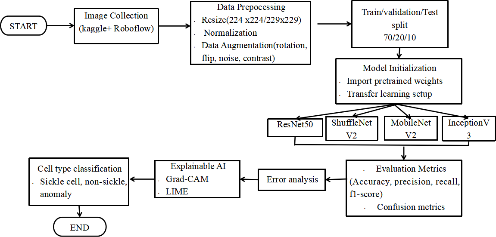
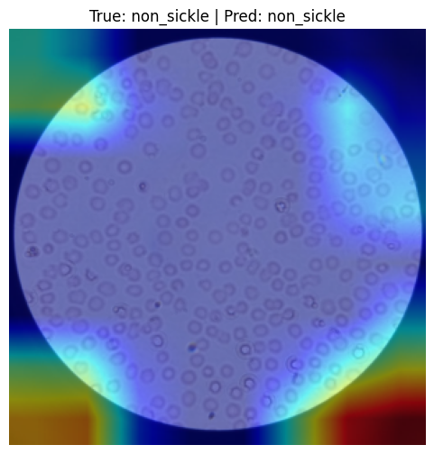

# Sickle Cell Classification from Blood Smear Images

[](LICENSE)


Transfer-learning classifiers that label individual red blood cells in microscopic blood smear images as **sickle**, **non-sickle** or **AIN** (anomaly / unclear). The project accompanies the paper *AI-Powered Medical Imaging for Fast and Accurate Sickle Cell Detection* (G H Raisoni College of Engineering, Nagpur).

> **Research software, not a medical device.** Do not use these models for clinical diagnosis.

> **Read before citing:** the paper's headline ResNet50 result (87.28%) is not supported by the confusion matrix published for that model, which implies 50.89% on the same 448-image test set. Three of the four models reproduce their reported accuracy exactly. See [`docs/RESULTS.md`](docs/RESULTS.md) for the full analysis.

**Explore the results interactively:** open [`docs/index.html`](docs/index.html) in a browser, or enable GitHub Pages on the `docs/` folder.

---

## Contents

- [Overview](#overview)
- [Results](#results)
- [Dataset](#dataset)
- [Method](#method)
- [Repository structure](#repository-structure)
- [Installation](#installation)
- [Usage](#usage)
- [Explainability](#explainability)
- [Verification and tests](#verification-and-tests)
- [Known issues and limitations](#known-issues-and-limitations)
- [Citation](#citation)
- [License](#license)

## Overview

Sickle cell disease (SCD) is an inherited haemoglobin disorder that requires early and accurate diagnosis. Manual microscopic review is slow, labour-intensive and prone to observer variation, which matters most in resource-limited settings. This project compares four ImageNet-pretrained CNNs fine-tuned on merged blood smear data and adds Grad-CAM and LIME explanations so that predictions can be checked against cell morphology.

## Results

Test set: 448 images, three classes. Figures below are recomputed from the paper's confusion matrices (`python scripts/recompute_metrics.py`).

| Model | Reported accuracy | Recomputed accuracy | Macro-F1 (recomputed) | Sickle-class recall (recomputed) | Status |
|---|---:|---:|---:|---:|:--|
| ShuffleNetV2 | 85.94% | 85.94% | 0.855 | 0.902 | Reproduces |
| MobileNetV2 | 83.71% | 83.71% | 0.829 | 0.913 | Reproduces |
| InceptionV3 | 83.04% | 83.04% | 0.823 | 0.908 | Reproduces |
| ResNet50 | 87.28% | **50.89%** | 0.477 | 0.740 | **Does not reproduce** |

Sickle-class F1 is 0.95 for the three reproducible models. Full confusion matrices, per-class metrics and the list of discrepancies are in [`docs/RESULTS.md`](docs/RESULTS.md).

## Dataset

The dataset is not redistributed in this repository. It is available on Hugging Face: [Sanika2903/sickle-cell-classification-dataset](https://huggingface.co/datasets/Sanika2903/sickle-cell-classification-dataset). It merges a Kaggle blood smear collection (Eastern Uganda, Field and Leishman stains) with a Roboflow hematology dataset. Check the licence of each source before use. Expected folder layout is in [`data/README.md`](data/README.md).

Split reported in the paper: 2,789 train, 459 validation, 448 test (3,696 total). Note that these counts do not match the 70 / 20 / 10 proportions stated in the text.

## Method

1. **Collection and cleaning:** remove corrupted and redundant images.
2. **Annotation:** three classes, `AIN`, `non_sickle`, `sickle`.
3. **Preprocessing:** resize to 224×224 (InceptionV3: 299×299) and normalise with ImageNet statistics.
4. **Augmentation (training only):** horizontal flip, rotation ±15°, colour jitter, random resized crop (80–100%).
5. **Transfer learning:** pretrained backbone with a new 3-class head; AdamW (lr 1e-4, weight decay 1e-4), cross-entropy, cosine annealing.
6. **Evaluation:** accuracy, precision, recall, F1, confusion matrices and error analysis.
7. **Explainability:** Grad-CAM and LIME.



## Repository structure

```
.
├── README.md
├── LICENSE
├── CITATION.cff
├── requirements.txt / requirements-dev.txt
├── pytest.ini
├── src/sickle_cell/          # importable package
│   ├── config.py             # classes, input sizes, checkpoint paths
│   ├── models.py             # architectures and checkpoint loading
│   ├── preprocess.py         # train / eval transforms
│   ├── predict.py            # SickleCellClassifier API
│   ├── gradcam.py            # Grad-CAM implementation
│   └── metrics.py            # accuracy, per-class P/R/F1, macro-F1 (pure Python)
├── scripts/
│   ├── predict.py            # command-line inference (+ Grad-CAM overlay)
│   ├── verify_checkpoints.py # SHA-256 check and load test
│   └── recompute_metrics.py  # recompute paper metrics from confusion matrices
├── models/                   # trained checkpoints, MODEL_CARD.md, SHA256SUMS
├── results/                  # confusion matrices and reported vs recomputed metrics (JSON)
├── docs/
│   ├── index.html            # interactive dashboard (no external dependencies)
│   ├── RESULTS.md            # full results and verification notes
│   ├── figures/              # figures extracted from the paper
│   └── paper/                # the manuscript (.docx)
├── data/README.md            # how to obtain and lay out the dataset
├── tests/                    # pytest suite
└── .github/workflows/ci.yml  # runs tests on every push
```

## Installation

Requires Python 3.10 or newer.

```bash
git clone https://github.com/<your-username>/sickle-cell-classification.git
cd sickle-cell-classification
git lfs install && git lfs pull          # the .pth checkpoints are stored with Git LFS
python -m venv .venv && source .venv/bin/activate
pip install -r requirements-dev.txt
```

For a CPU-only PyTorch build, first run `pip install torch torchvision --index-url https://download.pytorch.org/whl/cpu`.

## Usage

### Check the checkpoints

```bash
python scripts/verify_checkpoints.py --load
```

### Command line

```bash
python scripts/predict.py --model shufflenet --image path/to/smear.png
python scripts/predict.py --model resnet50 --image path/to/smear.png --gradcam gradcam.png
```

Output is JSON with the predicted class and probabilities for each class.

### Python

```python
from sickle_cell.predict import SickleCellClassifier

clf = SickleCellClassifier("shufflenet")          # or "resnet50", "mobilenet", "inception"
probs = clf.predict("path/to/smear.png")
print(max(probs, key=probs.get), probs)
```

Model keys: `resnet50`, `shufflenet`, `mobilenet`, `inception`.

### Interactive dashboard

Open `docs/index.html` directly, or publish `docs/` with GitHub Pages (Settings → Pages → Deploy from branch → `/docs`). The dashboard includes model comparison charts, confusion-matrix explorer, a live metric calculator, dataset split analysis, the method stepper and the explainability figures.

## Explainability

Grad-CAM highlights the regions that most influenced a prediction; LIME identifies superpixels that support or oppose the decision. In the paper these were used qualitatively, to check that attention falls on cell morphology rather than background. They are illustrative and have not been evaluated quantitatively.




## Verification and tests

```bash
pytest -q                               # metric, config and preprocessing tests
python scripts/recompute_metrics.py     # recompute paper metrics from confusion matrices
```

The metric code is pure Python, so the recomputation runs without PyTorch. CI runs the test suite on every push.

## Known issues and limitations

- **ResNet50 discrepancy.** The paper's confusion matrix for ResNet50 does not support the reported 87.28%. Until the checkpoint is re-evaluated on the test set, treat it as unverified. Re-evaluation requires the dataset, which is not in this repository.
- **Split proportions.** The stated 70 / 20 / 10 split does not match the reported counts (about 75 / 12 / 12).
- **Single dataset.** No external, multi-site or prospective validation.
- **Data provenance.** Confirm the licence terms of both source datasets and the ethics status of patient images before reuse.
- **Explanations** are qualitative examples, not a validated clinical interpretation method.

Full list: [`docs/RESULTS.md`](docs/RESULTS.md) (section 3).

## Citation

If you use this code or the associated paper, please cite it using [`CITATION.cff`](CITATION.cff) (GitHub shows a "Cite this repository" button automatically).

## License

Code and model weights are released under the MIT License. See [`LICENSE`](LICENSE). The datasets are subject to their own licences.

## Acknowledgements

Thanks to the authors of the Kaggle and Roboflow blood smear datasets, and to the `timm` and `torchvision` maintainers.
