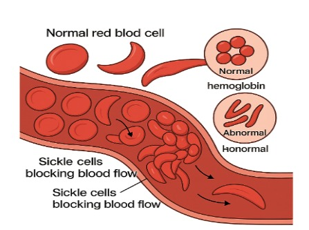
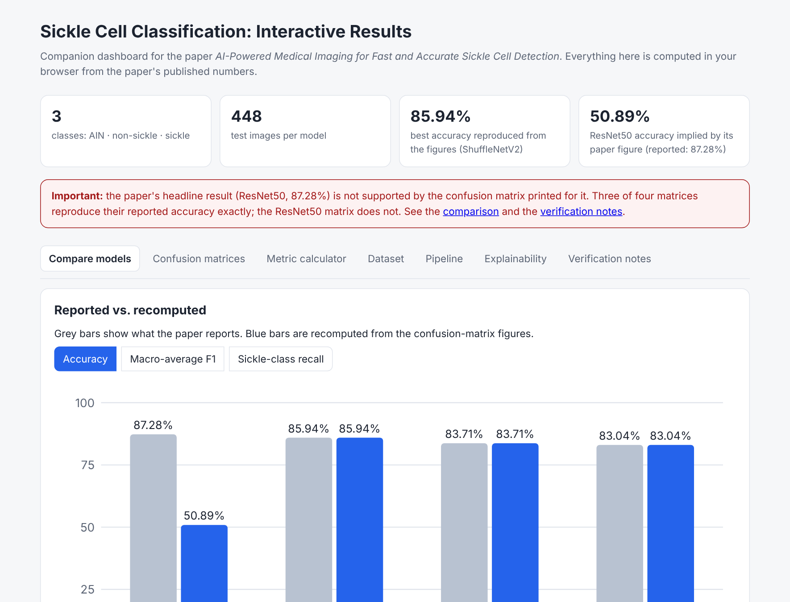
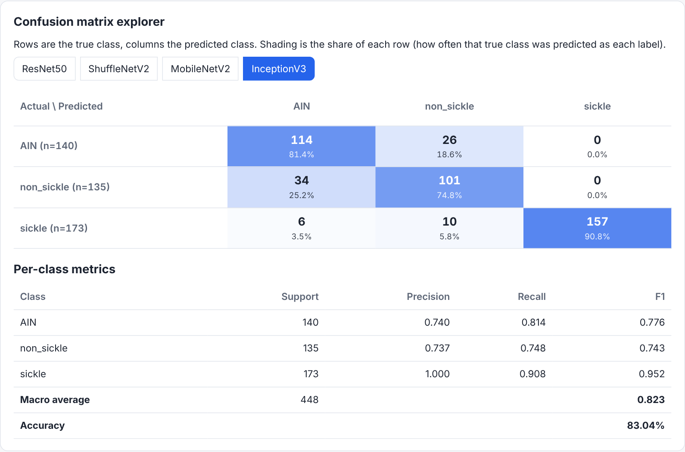
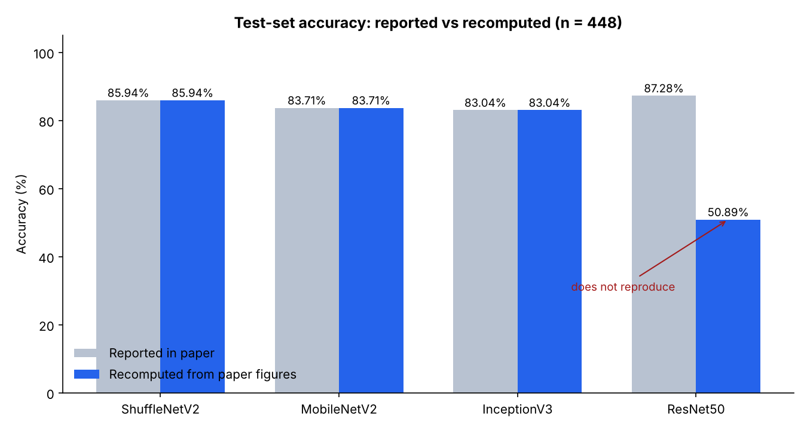
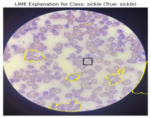

<div align="center">



# Sickle Cell Classification from Blood Smear Images

Transfer-learning CNNs that classify individual red blood cells in microscopic smear images as **sickle**, **non-sickle** or **AIN** (anomaly / unclear), with Grad-CAM and LIME explanations.

[](https://www.python.org/)
[](https://pytorch.org/)
[](tests/)
[](#limitations)

**[🔗 Live interactive dashboard](https://sh2680.github.io/Sickle_Cell_Detection/)** &nbsp;·&nbsp; [Results](#results) &nbsp;·&nbsp; [Quick start](#quick-start) &nbsp;·&nbsp; [Method](#method) &nbsp;·&nbsp; [Full results report](docs/RESULTS.md) &nbsp;·&nbsp; [Paper](docs/paper/Paper_id_1236_Sickle_cell_.docx)

</div>

> [!WARNING]
> **Research software only.** These models are not a medical device and must not be used for clinical diagnosis.

> [!IMPORTANT]
> **The paper's headline ResNet50 accuracy (87.28%) is not supported by the confusion matrix published for that model**, which implies **50.89%** on the same 448-image test set. The other three models reproduce their reported accuracy exactly. Read [`docs/RESULTS.md`](docs/RESULTS.md) before citing any ResNet50 figure.

---

## Contents

- [Overview](#overview)
- [Dashboard](#dashboard)
- [Results](#results)
- [Method](#method)
- [Explainability](#explainability)
- [Quick start](#quick-start)
- [Usage](#usage)
- [Repository structure](#repository-structure)
- [Verification and tests](#verification-and-tests)
- [Dataset](#dataset)
- [Limitations](#limitations)

---

## Overview

Sickle cell disease (SCD) is an inherited blood disorder that requires early and accurate diagnosis. Manual microscopic review is slow, labour-intensive and prone to observer variation, which matters most in resource-limited settings.

This project fine-tunes four ImageNet-pretrained CNNs on a merged blood smear dataset and adds Grad-CAM and LIME explanations, so that predictions can be checked against cell morphology.

| | |
|---|---|
| **Task** | Three-class cell classification: `sickle`, `non_sickle`, `AIN` |
| **Architectures** | ResNet50, ShuffleNetV2, MobileNetV2, InceptionV3 |
| **Input** | Microscopic blood smear images, resized to 224×224 (299×299 for InceptionV3) |
| **Explainability** | Grad-CAM heatmaps and LIME superpixel explanations |
| **Test set** | 448 images |

---

## Dashboard

An interactive, self-contained web dashboard accompanies the project. It runs entirely in the browser and requires no installation.

[](https://sh2680.github.io/Sickle_Cell_Detection/)

| Tab | Contents |
|---|---|
| **Compare models** | Reported vs recomputed accuracy, macro-F1 and sickle-class recall |
| **Confusion matrices** | Heatmap for each model with per-class precision, recall and F1 |
| **Metric calculator** | Edit any count in a 3×3 matrix and see the metrics update live |
| **Dataset** | Stated 70/20/10 split compared with the reported counts |
| **Pipeline** | Step-by-step description of the method |
| **Explainability** | Grad-CAM and LIME example figures |
| **Verification notes** | Inconsistencies found in the paper |

[](https://sh2680.github.io/Sickle_Cell_Detection/)

**Open the dashboard:** [sh2680.github.io/Sickle_Cell_Detection](https://sh2680.github.io/Sickle_Cell_Detection/)

To run it offline, open [`docs/index.html`](docs/index.html) in any browser.

---

## Results

Test-set accuracy on 448 images. Recomputed values are derived from the paper's confusion-matrix figures using [`scripts/recompute_metrics.py`](scripts/recompute_metrics.py).



| Model | Reported accuracy | Recomputed accuracy | Macro-F1 | Sickle-class recall | Reproduces |
|---|---:|---:|---:|---:|:---:|
| ShuffleNetV2 | 85.94% | 85.94% | 0.855 | 0.902 | ✅ |
| MobileNetV2 | 83.71% | 83.71% | 0.829 | 0.913 | ✅ |
| InceptionV3 | 83.04% | 83.04% | 0.823 | 0.908 | ✅ |
| ResNet50 | 87.28% | **50.89%** | 0.477 | 0.740 | ❌ |

Sickle-class F1 is 0.95 for the three reproducible models. Full confusion matrices and per-class metrics are in [`results/`](results/) and [`docs/RESULTS.md`](docs/RESULTS.md).

---

## Method


1. **Collection and cleaning.** Images are gathered from Kaggle and Roboflow; corrupted and redundant samples are removed.
2. **Annotation.** Each cell is labelled `sickle`, `non_sickle` or `AIN`.
3. **Preprocessing.** Images are resized (224×224, or 299×299 for InceptionV3) and normalised with ImageNet statistics.
4. **Augmentation (training only).** Horizontal flip, rotation of ±15°, colour jitter and random resized crop (80–100% of area).
5. **Transfer learning.** Each pretrained backbone receives a new three-class head and is trained with AdamW (learning rate 1e-4, weight decay 1e-4), cross-entropy loss and cosine annealing.
6. **Evaluation.** Accuracy, precision, recall, F1, confusion matrices and error analysis.
7. **Explainability.** Grad-CAM and LIME check that the model attends to cell morphology rather than background.

<details>
<summary><b>Training details</b></summary>

| Setting | Value |
|---|---|
| Split (reported counts) | 2,789 train · 459 validation · 448 test (3,696 total) |
| Optimiser | AdamW, lr 1e-4, weight decay 1e-4 |
| Loss / scheduler | Cross-entropy / cosine annealing |
| Epochs | 10 (MobileNetV2, ShuffleNetV2); more than 10 (InceptionV3); not stated (ResNet50) |
| InceptionV3 head | Dropout 0.5; auxiliary-loss weights 0.6 and 0.4 |

**Assumptions:** colour-jitter strengths and the ResNet50 dropout rate are not specified in the paper. The values used are documented in [`src/sickle_cell/preprocess.py`](src/sickle_cell/preprocess.py) and [`src/sickle_cell/models.py`](src/sickle_cell/models.py).

**Note:** the text states a 70/20/10 split, but the reported counts give about 75/12/12. See [`docs/RESULTS.md`](docs/RESULTS.md).

</details>

---

## Explainability

| Grad-CAM: where the model looks | LIME: which regions support the decision |
|:---:|:---:|
| [](docs/figures/fig7_gradcam.png) | [](docs/figures/fig8_lime.png) |

These examples are qualitative, taken from the paper. They have not been evaluated quantitatively.

---

## Quick start

**Requirements:** Python 3.10 or newer, and [Git LFS](https://git-lfs.com/). The model checkpoints are stored with Git LFS.

```bash
git clone https://github.com/Sh2680/Sickle_Cell_Detection.git
cd Sickle_Cell_Detection
git lfs install && git lfs pull

python -m venv .venv
source .venv/bin/activate          # Windows: .venv\Scripts\activate
pip install -r requirements-dev.txt
```

<details>
<summary><b>CPU-only PyTorch (smaller download)</b></summary>

```bash
pip install torch torchvision --index-url https://download.pytorch.org/whl/cpu
pip install -r requirements-dev.txt
```

</details>

---

## Usage

### Command line

```bash
# Classify an image
python scripts/predict.py --model shufflenet --image path/to/smear.png

# Classify and save a Grad-CAM overlay
python scripts/predict.py --model resnet50 --image path/to/smear.png --gradcam gradcam.png
```

Output is JSON containing the predicted class and the probability of each class.

### Python API

```python
from sickle_cell.predict import SickleCellClassifier

clf = SickleCellClassifier("shufflenet")       # "resnet50", "mobilenet" or "inception"
probs = clf.predict("path/to/smear.png")
print(max(probs, key=probs.get), probs)
```

### Models

| Key | Architecture | Input | File |
|---|---|:---:|---|
| `resnet50` | ResNet-50 (torchvision) | 224 | [`resnet50_sickle_dropout.pth`](models/resnet50_sickle_dropout.pth) |
| `shufflenet` | ShuffleNetV2 ×1.0 (torchvision) | 224 | [`shufflenet_sickle.pth`](models/shufflenet_sickle.pth) |
| `mobilenet` | MobileNetV2 (timm) | 224 | [`mobilenet_sickle.pth`](models/mobilenet_sickle.pth) |
| `inception` | InceptionV3 (timm) | 299 | [`inception_v3_full_model.pth`](models/inception_v3_full_model.pth) |

Architecture details and checksums are in the [model card](models/MODEL_CARD.md).

---

## Repository structure

```
Sickle_Cell_Detection/
├── src/sickle_cell/         Package: models, preprocessing, prediction, Grad-CAM, metrics
├── scripts/                 Command-line tools: predict, verify_checkpoints, recompute_metrics
├── models/                  Trained checkpoints, MODEL_CARD.md, SHA256SUMS
├── results/                 Confusion matrices and metrics (JSON)
├── docs/
│   ├── index.html           Interactive dashboard
│   ├── RESULTS.md           Full results and verification report
│   ├── figures/             Figures from the paper and dashboard screenshots
│   └── paper/               Manuscript
├── tests/                   pytest suite
├── data/README.md           Dataset instructions
└── .github/workflows/       Continuous integration
```

---

## Verification and tests

```bash
pytest -q                              # metric, configuration and preprocessing tests
python scripts/verify_checkpoints.py --load   # checksums, then load each model
python scripts/recompute_metrics.py    # recompute metrics from the paper's matrices
```

- All four checkpoints match their SHA-256 checksums and load with `strict=True`.
- Prediction and Grad-CAM run for all four models.
- The metric code is pure Python and runs without PyTorch.
- Continuous integration runs the test suite on every push.

---

## Dataset

The dataset is not redistributed in this repository. It is available on Hugging Face:
[Sanika2903/sickle-cell-classification-dataset](https://huggingface.co/datasets/Sanika2903/sickle-cell-classification-dataset).

It merges a Kaggle blood smear collection (Eastern Uganda; Field and Leishman stains) with a Roboflow hematology dataset. Check the terms of use of each source before use. Expected folder layout: [`data/README.md`](data/README.md).

---

## Limitations

- **ResNet50 discrepancy.** The paper's ResNet50 confusion matrix does not support the reported 87.28%. Re-evaluate the checkpoint on the test set before citing it.
- **Split proportions.** The stated 70/20/10 split does not match the reported counts.
- **Single merged dataset.** There is no external, multi-site or prospective validation.
- **Data provenance.** Confirm the terms of use of both source datasets and the ethics status of patient images before reuse.
- **Explanations** are qualitative examples, not a validated clinical method.

Full list with evidence: [`docs/RESULTS.md`](docs/RESULTS.md).
